<p align="center">
  
</p>

<h1 align="center">Orchestra</h1>

<p align="center">
  Un gestor de terminales, SSH y agentes de IA para Windows.<br>
  <a href="README.md">Read in English</a>
</p>

<p align="center">
  <a href="LICENSE"></a>
  
  
</p>

Orchestra coloca tus terminales en una cuadrícula ajustable a la derecha y, a la izquierda, una barra lateral con tus cuentas de
Claude / Codex / opencode, tus hosts SSH, tus shells locales y, en directo, lo que está haciendo cada agente de IA. Está hecho con
Tauri 2 (Rust), Svelte 5 y xterm.js: un ejecutable de unos 15 MB, sin Electron.

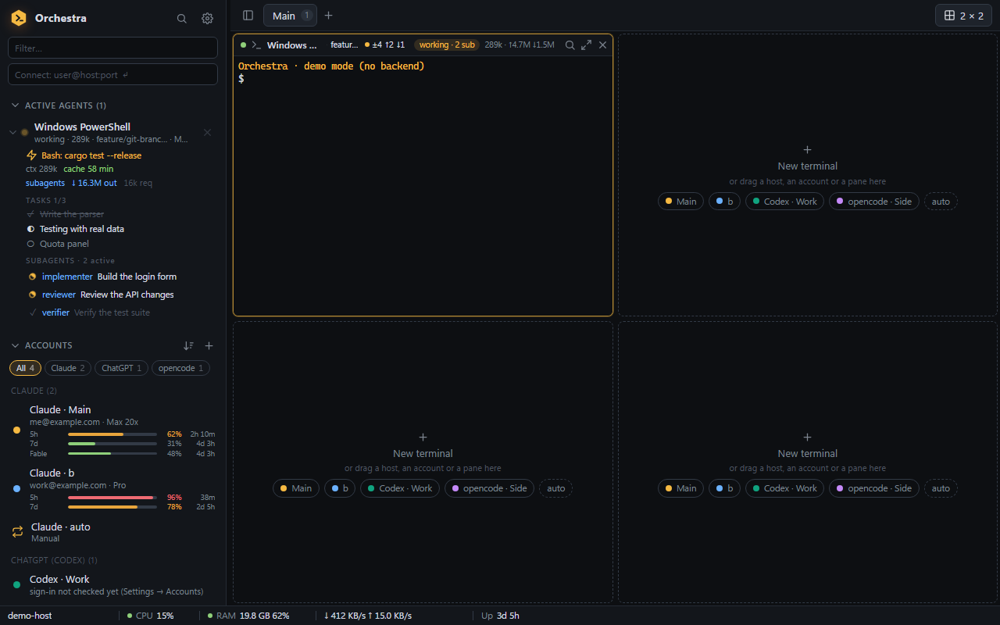

> Las capturas de este repositorio están hechas en el **modo demo** integrado (datos falsos, sin backend). Orchestra es un proyecto
> joven: lee [Estado y limitaciones conocidas](#estado-y-limitaciones-conocidas) antes de fiarte de una función.

## Por qué Orchestra

- **Varias suscripciones de IA, una sola ventana.** Ten todas las cuentas de Claude que tengas (y también de Codex u opencode), mira
  cuánta cuota queda en cada ventana de 5 horas / 7 días y abre un terminal con la cuenta correcta con un clic.
- **Agentes que puedes vigilar.** La barra lateral muestra cada agente en marcha (estado, herramienta actual, tamaño de contexto,
  cuenta atrás de la caché del prompt, tareas, subagentes, tokens). Haz clic en un subagente para seguir su transcripción en directo.
- **Terminales que sobreviven.** El backend en Rust es el dueño de los procesos: al cerrar la ventana, Orchestra se oculta en la
  bandeja y tus sesiones siguen funcionando.
- **SSH sin fricción.** Usa el `ssh.exe` del sistema, así que tus claves, ssh-agent, `~/.ssh/config` y `ProxyJump` funcionan tal
  cual, y añade una bóveda de contraseñas, reconexión automática y una insignia de latencia.
- **Claro con la privacidad.** Sin telemetría; la única función de red aparte de SSH es opcional. Mira
  [Seguridad y privacidad](#seguridad-y-privacidad).

## Funciones

**Terminales y diseños**
- Cuadrícula ajustable (1×1, 2×1, 1×2, 2×2, 3×3, 4×4 …) con divisores alineados que se arrastran, varios espacios de trabajo
  (pestañas), maximizar, búsqueda en el panel y arrastrar y soltar.
- PTY reales (ConPTY). La salida se guarda en un búfer (2 MiB por terminal) y se reproduce al volver la ventana desde la bandeja.
- PowerShell, cmd, Git Bash y las distribuciones de WSL se detectan automáticamente.
- Menús contextuales (barra lateral, cuentas, fondo de la cuadrícula, barra de estado) y paleta de comandos (`Ctrl+Shift+P`).
- **Pegar imágenes** en un terminal (`Ctrl+V` con una imagen en el portapapeles, o soltando archivos de imagen en un panel): los
  paneles locales reciben la ruta de un PNG guardado en una carpeta de caché; en los paneles SSH la imagen se sube antes al
  servidor. **Copiar** va por el portapapeles del sistema con aviso visible («Copiado» / error), también desde aplicaciones que usan
  el ratón (mantén `Mayús` para seleccionar) y por OSC 52.

**SSH**
- Lista de hosts con grupos y etiquetas, importación de `~/.ssh/config`, conexión rápida (`usuario@host:puerto`), sesión `tmux`
  persistente opcional, host de salto, y color y notas por host.
- **Bóveda**: las contraseñas y frases de paso de las claves se guardan en el **Administrador de credenciales de Windows** (nunca en
  el archivo de estado) y se entregan a `ssh.exe` mediante un ayudante `SSH_ASKPASS`, de modo que no se teclea nada en el terminal.
- **Política de claves de host** para hosts con secreto guardado: *Confirmar hosts nuevos* (por defecto; enseña primero la huella) o
  *Confiar en el primer uso*, global y con ajuste propio por host.
- Gestor de claves SSH: lista las claves de `~/.ssh`, genera una clave ed25519, copia la clave pública e instálala en un servidor.
- **Reconexión automática** con espera creciente cuando se cae una sesión ya establecida (barra con cuenta atrás, *Reconectar
  ya*, *Cancelar*) e **insignia de latencia** en la cabecera de cada panel SSH (verde / ámbar / rojo; el tooltip da última,
  mínima, media, máxima y pérdidas). Ambas vienen activadas y todas las cifras se pueden ajustar. Un panel SSH caído se cubre con
  su estado (reconectando, intento N, o se rindió y por qué) y, al volver, un separador marca cuánto estuvo caído.
- Cajón de **Archivos** (SFTP) por panel SSH: navegar, filtrar, subir (botón o soltando), descargar, crear carpetas, renombrar y
  borrar, con progreso y cancelación. Habla SFTP por el mismo `ssh.exe`, así que claves, bóveda y hosts de salto funcionan igual.
- **Reenvío de puertos**: cuando un programa de un panel SSH empieza a escuchar (por ejemplo un servidor de desarrollo en
  `localhost:3000`), un aviso ofrece reenviarlo; la insignia de puertos del panel lista los túneles (abrir en el navegador, copiar
  la URL, guardarlo para cada conexión, parar). Los túneles se reconectan solos y conservan el mismo puerto local.
- **Métricas del servidor** opcionales en la barra de estado (CPU, RAM, disco, red y tiempo en marcha del *servidor*), leídas por una
  segunda conexión SSH pequeña; por host, desactivadas por defecto, solo servidores Linux.

**Agentes de IA (Claude, Codex, opencode)**
- Cuentas para los tres agentes. Claude: un `CLAUDE_CONFIG_DIR` por suscripción (historial, agentes, skills y plugins se comparten
  con enlaces de carpeta). Codex: un `CODEX_HOME` cada una (dos funcionan a la vez). opencode: una carpeta de datos cada una. Las
  cuentas de la barra lateral se pueden **filtrar, agrupar por proveedor y ordenar**.
- Elige o cambia la cuenta por terminal; al cambiar, se relanza la conversación del panel con la otra cuenta.
- Las conversaciones de Claude **se retoman tras reiniciar** (`claude --resume <id>`).
- **Barras de uso** (ventanas de 5 horas y 7 días, tiempo hasta el reinicio) tomadas de la línea de estado de Claude Code, y una
  consulta a Anthropic **opcional** que funciona incluso sin ningún terminal abierto.
- **Árbol de agentes activos** con estado, tareas, subagentes y tokens por sesión (hilo principal y subagentes por separado); clic
  para enfocar el terminal. **`Ctrl+Shift+A`** salta al siguiente agente que te espera (también en otras pestañas) y la lista
  *Necesitan atención* los enseña todos; aviso de Windows opcional cuando Orchestra no está delante. **Visor de subagentes**: un cajón de solo lectura que sigue en directo la transcripción de un subagente.
- Política de selección de cuenta (manual, por turnos, reinicio más cercano, más cuota libre) y **autocompactado** opcional mientras
  estás ausente (escribe `/compact` en un Claude inactivo poco antes de que caduque su caché del prompt; experimental).
- Un **servidor MCP** local permite que los agentes vean los hosts y terminales que permitas expresamente (permiso por host,
  registro de auditoría). El acceso por host es `read` (los agentes leen terminales), `ask` (también pueden ejecutar un comando con `run_command`, pero solo tras aprobar tú ese comando exacto en un diálogo) o `full` (ejecutan comandos sin preguntar). Cada intento queda auditado.
- **Vista MCP** (barra superior → **MCP**): todos los servidores MCP de todas las cuentas en una tabla (ámbitos usuario y local de
  Claude, Codex, opencode). Pruébalos (herramientas encontradas, o por qué no), instala uno en varias cuentas a la vez desde un
  formulario o pegando el comando de un README, compara lado a lado cuando el mismo servidor tiene dos versiones e iguala las demás
  a una, quítalo, y apruébalo, enciéndelo o inicia sesión donde la cuenta lo pida. Cada cambio enseña antes la edición exacta y se
  puede deshacer. Cada servidor muestra cuántos tokens, aproximadamente, añaden sus herramientas a cada sesión.
- **Vista Consumo** (barra superior → **Consumo**): adónde van los tokens de Claude Code, leído de las transcripciones locales (no
  se envía nada). Por periodo (hoy, 7 o 30 días), sesión, proyecto, modelo y subagente, en equivalentes de token de entrada o en
  USD estimados a precios de la API; un cajón por panel muestra la sesión actual. Las tarjetas de **consejos** señalan los mayores
  derroches (ficheros leídos enteros una y otra vez, cachés que caducan en las pausas, una base fija pesada…) con el ahorro como
  «antes → después» y la suposición que hay detrás. **Copiar informe para tu IA** da un resumen en Markdown para pegar en un chat, y
  el servidor MCP ofrece el mismo informe como herramienta `usage_report`.

**Barra de estado**
- Una barra fina abajo: nombre del equipo, CPU, RAM, lectura/escritura de disco, red de bajada/subida, tiempo encendido, agentes
  trabajando / esperando y la ventana de uso de Claude más alta. Elige, reordena y ajusta el ritmo de los elementos; clic derecho
  para un menú rápido.
- **Por pestaña**: cada pestaña puede tener sus propios elementos, y los elementos de contexto (panel enfocado, destino SSH, rama de
  git, latencia SSH, cuenta y estado del agente) siguen al panel enfocado.

**Etiqueta de rama de git**
- Una etiqueta en la cabecera de cada panel local: rama, archivos modificados, commits por delante / por detrás; punto ámbar =
  cambios, rojo = conflictos o un rebase / merge en curso. Solo lectura (solo `git status` / `rev-parse`). Los paneles SSH todavía no
  muestran nada.

**Personalización**
- 21 temas de color integrados, más importación de temas de Windows Terminal, iTerm2, Alacritty y Orchestra; exporta y renombra los
  tuyos.
- Fuentes (con comprobación de «instalada en este PC»), cursor, historial, color de acento, notificaciones, intervalos de escaneo.
- **Copia de seguridad / restauración**: *Exportar todo* a un único archivo JSON (ajustes, hosts SSH, cuentas, temas, espacios de
  trabajo; sin contraseñas ni sesiones) e *Importar todo* (combinar o reemplazar, sección por sección).
- Interfaz en **inglés y español** (sigue a Windows por defecto).

## Capturas

| | |
|---|---|
| 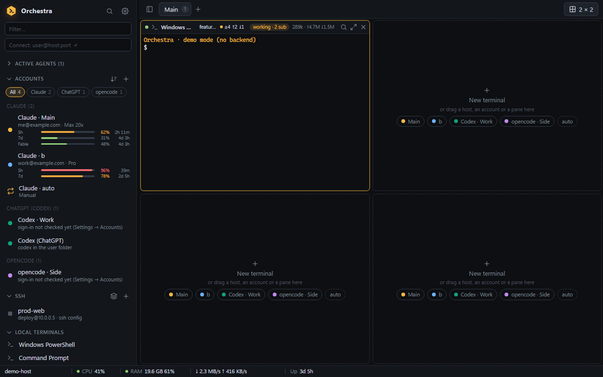<br>Cuentas agrupadas por proveedor, con barras de uso | 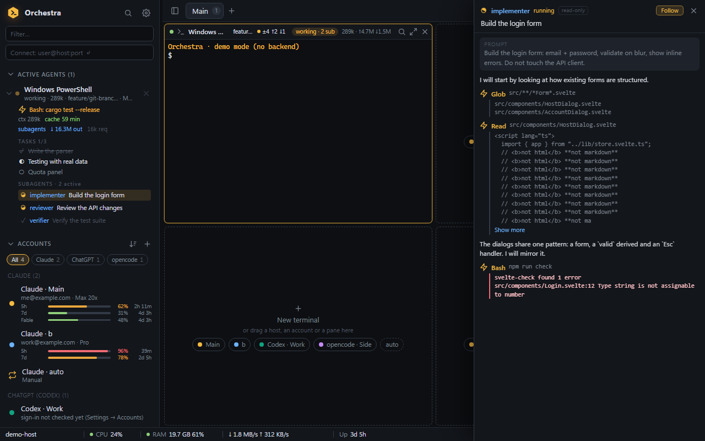<br>Visor de subagentes: transcripción en directo, solo lectura |
| 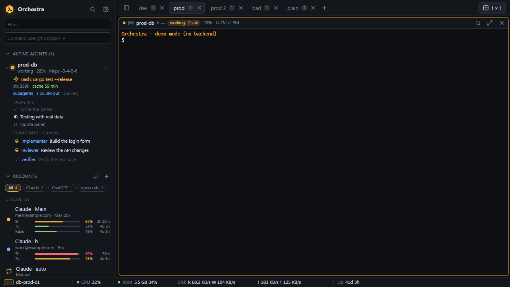<br>Barra de estado de una pestaña SSH con las métricas del servidor | 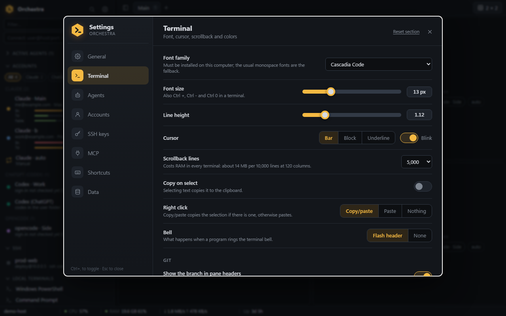<br>Ajustes → Terminal |
| 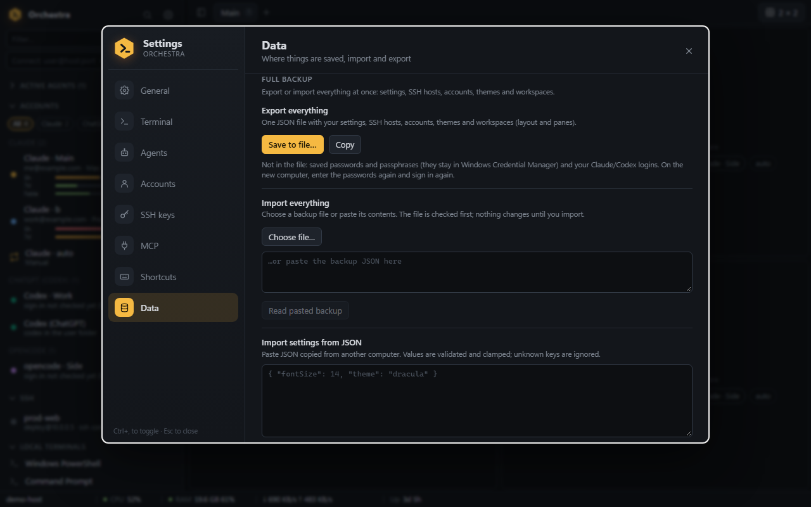<br>Ajustes → Datos: copia de seguridad completa | 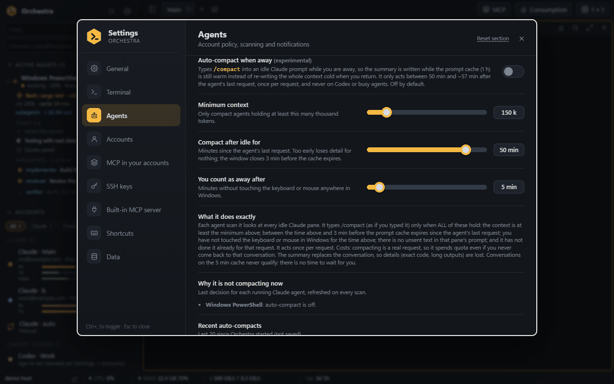<br>Ajustes → Agentes: autocompactado en ausencia, y por qué no actúa ahora |
| 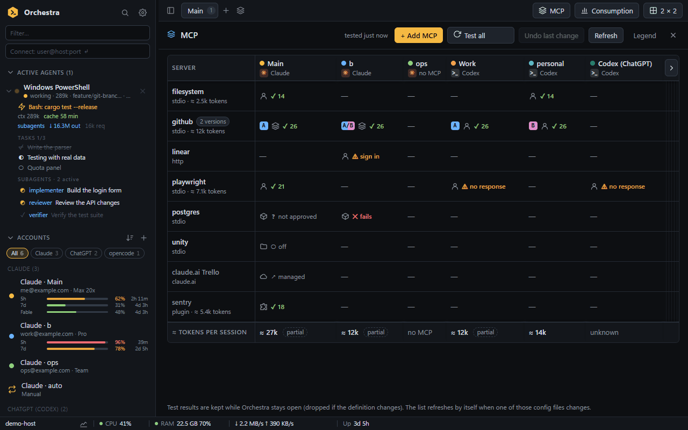<br>Vista MCP: todos los servidores de todas las cuentas, probados, con dos versiones de uno | 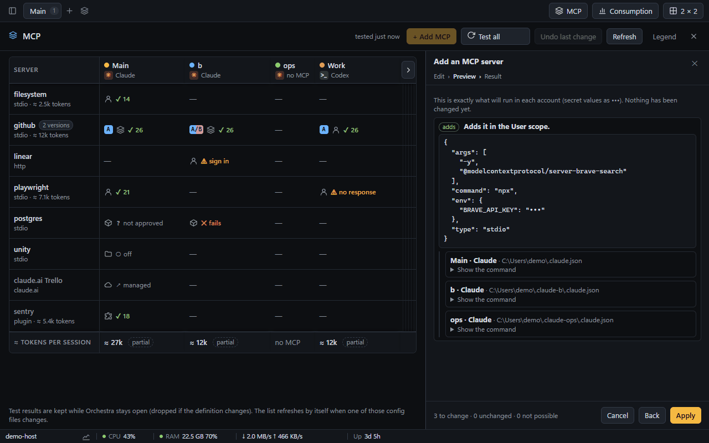<br>Instalar un servidor en tres cuentas: el cambio exacto, antes de aplicarlo |
| 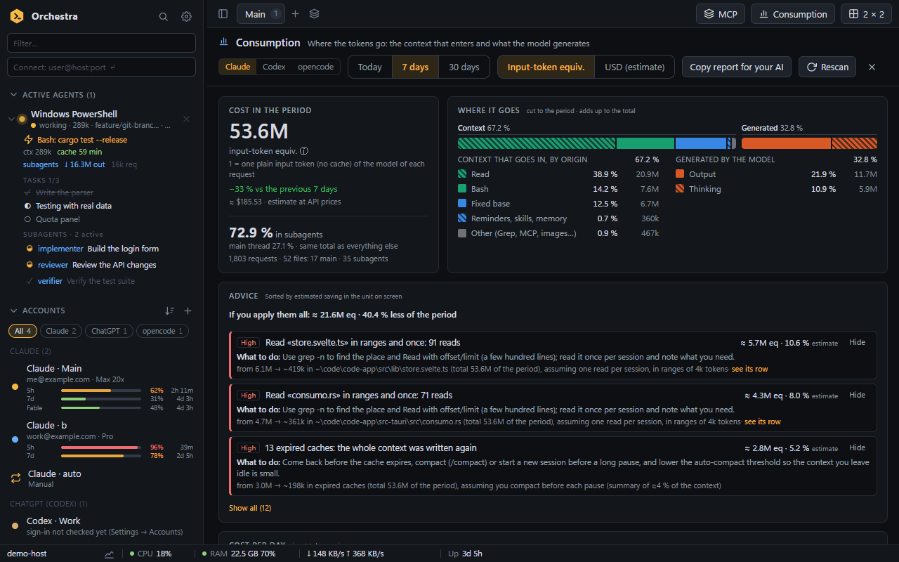<br>Consumo de los últimos 7 días: adónde van los tokens y consejos con el ahorro | 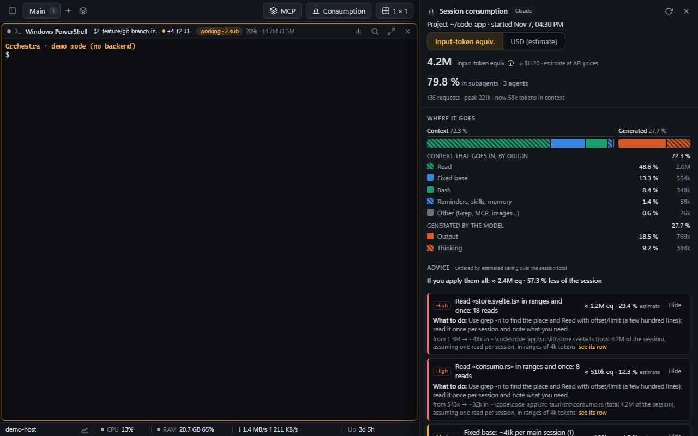<br>Consumo de una sesión, junto a su terminal |

Las capturas están en inglés (la interfaz base).

## Instalación

Descarga los archivos desde la página de [Releases](../../releases). Hay dos opciones:

| Archivo | Qué es |
|---|---|
| `Orchestra_0.4.1_x64-setup.exe` | Instalador NSIS, **por usuario** (sin permisos de administrador), en inglés / español. |
| `Orchestra_0.4.1_x64-portable.exe` | Ejecutable portátil (unos 15 MB). Ponlo donde quieras y ejecútalo. |

Notas:

- **Windows 10 u 11 (64 bits)** con el **runtime de Microsoft Edge WebView2**. Viene con Windows 11 y con Windows 10 actualizado; si
  falta, instálalo desde Microsoft («Evergreen Runtime»).
- **Los binarios no están firmados**, así que SmartScreen de Windows puede avisar («Windows protegió su PC»). Si has descargado el
  archivo desde la página de Releases de este repositorio, elige *Más información → Ejecutar de todas formas*.
- **Actualizaciones:** la versión instalada mira la página de Releases al arrancar y cada 6 horas (Ajustes → General, se puede
  apagar) y avisa cuando hay una versión nueva. *Actualizar* descarga el instalador, comprueba su firma, lo instala y reinicia
  Orchestra; tus paneles y sesiones de Claude se restauran. El exe portátil solo ofrece abrir la página de descarga.
- Para SSH necesitas el cliente OpenSSH (`ssh.exe`, una característica opcional de Windows que suele venir ya instalada). Para la
  etiqueta de git necesitas `git` en el `PATH`. Para los agentes necesitas la CLI del propio agente (`claude`, `codex`, `opencode`)
  en el `PATH`.
- **Dónde están tus datos:** `%APPDATA%\dev.orchestra.app\` (`state.json`, `quota\`, `mcp\`, `bin\`). Define la variable de entorno
  `ORCHESTRA_DATA_DIR` con una carpeta para usar esa carpeta en su lugar (útil para uso portátil o para probar sin tocar tus datos).
  Los secretos viven en el Administrador de credenciales de Windows, con el nombre de servicio `dev.orchestra.app`.

## Primeros pasos

1. Abre Orchestra. Pulsa `Ctrl+Shift+T` (o haz clic en una casilla **Nuevo terminal** de la cuadrícula) para abrir tu primer shell.
2. **Añade una cuenta** si usas un agente de IA: el `+` junto a **CUENTAS** en la barra lateral → elige Claude, Codex u opencode →
   créala y luego inicia sesión en el terminal que se abre (`/login` en Claude, el botón *Iniciar sesión* en Codex y opencode).
3. **Añade un host SSH**: el `+` junto a **SSH**, o escribe `usuario@host:puerto` en el cuadro *Conectar* y pulsa Enter. Elige
   *Contraseña (guardada de forma segura)* en el diálogo del host si quieres usar la bóveda.
4. Cambia el **diseño** con el botón de la cuadrícula arriba a la derecha (por ejemplo 2 × 2) y arrastra hosts, cuentas o paneles a
   las casillas.
5. Abre los **Ajustes** (`Ctrl+,`) para elegir tema y fuente, y afinar la barra de estado, la reconexión automática y más. Pulsa
   `Ctrl+Shift+P` en cualquier momento para la paleta de comandos.

Hay recetas paso a paso (en inglés) en la [Guía de usuario](docs/USER_GUIDE.md).

## Atajos de teclado

Funcionan aunque un terminal tenga el foco. Todavía no se pueden reasignar. La misma lista está en Ajustes → Atajos.

| Atajo | Acción |
|---|---|
| `Ctrl+,` | Abrir los ajustes (alternar) |
| `Ctrl+Shift+P` | Paleta de comandos |
| `Ctrl+Shift+B` | Mostrar / ocultar la barra lateral |
| `Esc` | Cerrar el diálogo abierto |
| `Ctrl+Shift+T` | Terminal nuevo (primer shell) |
| `Ctrl+Shift+W` | Cerrar el panel enfocado |
| `Ctrl+Shift+Enter` | Maximizar / restaurar el panel enfocado |
| `Ctrl+Shift+F` | Buscar en el panel enfocado |
| `Alt+←` `Alt+→` `Alt+↑` `Alt+↓` | Mover el foco entre paneles |
| `Alt+1` … `Alt+9` | Ir al panel número N |
| `Ctrl+PageUp` / `Ctrl+PageDown` | Espacio de trabajo anterior / siguiente |
| `Ctrl++` / `Ctrl+-` | Fuente del terminal más grande / más pequeña |
| `Ctrl+0` | Restablecer el tamaño de fuente del terminal |
| `Ctrl+C` | Copiar si hay selección (si no, se envía al programa) |
| `Ctrl+Shift+C` / `Ctrl+V` | Copiar la selección / pegar |

## Configuración

Todo está en **Ajustes** (`Ctrl+,`) y se aplica al instante. Pestañas: **General** (cierre de ventana, color de acento, idioma, barra
de estado), **Terminal** (fuente, cursor, historial, temas, etiqueta de git), **Agentes** (política de cuentas, intervalo de
escaneo, notificaciones, retomar, captura de uso, consulta de uso, autocompactado), **Cuentas**, **Claves SSH** (política de claves
de host, reconexión automática, insignia de latencia, gestor de claves), **MCP**, **Atajos** (solo lectura) y **Datos** (archivo de
estado, importar / exportar ajustes, copia de seguridad completa, restablecer).

Haz copia con **Ajustes → Datos → Copia de seguridad completa → Exportar todo**. En la [Guía de usuario](docs/USER_GUIDE.md#backup-and-restore)
se explica qué entra y qué no.

## Seguridad y privacidad

Orchestra se ejecuta con los permisos de tu usuario y solo habla con `127.0.0.1` y con los hosts SSH que configures.

- **Sin telemetría.** La única excepción es la **consulta de uso**, que está **desactivada por defecto**, pide confirmación expresa y
  hace una petición de solo lectura a `api.anthropic.com` por cada cuenta de Claude con sesión iniciada.
- **El archivo de estado (`state.json`) no contiene secretos**: solo diseño, hosts, cuentas y ajustes.
- **Las contraseñas y frases de paso SSH** van al Administrador de credenciales de Windows; ningún comando las devuelve a la interfaz.
- **Las credenciales de Claude / Codex / opencode nunca se copian ni se modifican.** Por defecto Orchestra no lee los tokens OAuth de
  Claude; solo lo hace la consulta de uso opcional (dos campos de `.credentials.json`, que nunca se guardan ni se registran).
- El **servidor MCP** escucha solo en `127.0.0.1`, protegido por un token secreto, y solo expone los hosts y terminales que permitas. La herramienta `run_command` es la única que puede cambiar algo: los hosts `read` la rechazan, los `ask` necesitan tu aprobación cada vez y los `full` la ejecutan directamente (mira [docs/SECURITY.md](docs/SECURITY.md)).
- Las copias de seguridad y los hosts exportados **no contienen secretos**; una copia importada se trata como dato no fiable y se
  valida.

Modelo completo, función por función (en inglés): [docs/SECURITY.md](docs/SECURITY.md). Para informar de una vulnerabilidad, mira
[SECURITY.md](SECURITY.md).

## Compilar desde el código fuente

Requisitos: Windows 10/11, **Node.js 20.19+ o 22.12+** (la CI usa 22), **Rust estable** con la cadena de herramientas MSVC (Visual
Studio Build Tools, «Desarrollo de escritorio con C++») y el runtime de WebView2.

```powershell
npm install
npm run tauri dev                              # desarrollo con recarga en caliente
npm run build                                  # solo la interfaz web (salida en dist/)
npx tauri build --debug --no-bundle            # ejecutable de depuración, sin instalador
npx tauri build --bundles nsis                 # compilación release + instalador NSIS
```

El ejecutable release queda en `src-tauri\target\release\orchestra.exe` y el instalador en
`src-tauri\target\release\bundle\nsis\`.

### Comprobaciones

```powershell
npm run check                                  # svelte-check (tipos)
npm test                                       # node --test: módulos TypeScript puros
npm run i18n:check                             # diccionarios, claves sin usar, texto fijo en el código
cd src-tauri; cargo test       # pruebas de Rust (ConPTY real, HTTP local, analizadores, seguridad)
```

La interfaz también funciona en un navegador normal (`npm run dev`, abre http://127.0.0.1:1420/) en **modo demo** con datos falsos,
que es como se hicieron las capturas.

Para probar una compilación real sin tocar tus datos, define `ORCHESTRA_DATA_DIR` con una carpeta vacía (y
`WEBVIEW2_USER_DATA_FOLDER` con otra) antes de arrancarla. El servidor MCP prefiere un puerto fijo (47821), así que dos instancias no
pueden tenerlo a la vez. Los detalles para contribuir están en [docs/CONTRIBUTING.md](docs/CONTRIBUTING.md) (en inglés).

## Estructura del proyecto

```
src/                  App Svelte 5 (components/) y lógica TypeScript pura (lib/, probada con node --test)
src/lib/locales/      Diccionarios de la interfaz: en/ (base) y es/
src-tauri/src/        Backend en Rust: PTY, ayudantes SSH, bóveda, agentes, cuotas, servidor MCP, git, métricas
src-tauri/tests/      Pruebas de integración de Rust (ayudante askpass)
scripts/              Comprobador de i18n y sus pruebas
docs/                 Arquitectura, seguridad, i18n, guía de usuario, contribución, capturas, notas internas
.github/              Flujo de CI, plantillas de issues y de pull requests
```

Índice de la documentación: [docs/README.md](docs/README.md).

## Estado y limitaciones conocidas

Orchestra 0.4.1 (la 0.1.0 fue la primera versión pública) es un proyecto de una sola persona. Novedades de la 0.4.1: espaciado entre letras en el terminal, y la lista de fuentes enseña todas las instaladas (antes solo ofrecía una lista fija). Novedades de la 0.4.0: actualizaciones automáticas, cajón de archivos SFTP, reenvío de puertos, pegar imágenes y copiar de forma fiable, reconexión SSH visible y la lista *Necesitan atención*, vista MCP y vista Consumo; cubiertas por tests, servidores falsos, un sshd local y la demo del navegador, pero SFTP, túneles y la subida de imágenes aún no se han usado contra un servidor real desde la ventana de escritorio (ver el [changelog](CHANGELOG.md)). Novedades de la 0.3.0: gráfica de uso, carpetas de hosts SSH, espacios guardados, ficha de agente y sonidos de aviso, probadas con tests y en la demo del navegador, pero aún no con agentes vivos ni un servidor SSH real en la app de escritorio. Novedad de la 0.2.0: la herramienta MCP `run_command`, cubierta por pruebas automáticas con un ejecutor falso y procesos locales reales, pero que el autor **no** ha probado aún contra un servidor SSH real. Qué está verificado y qué no:

- **Verificado con pruebas automáticas**: modelo de la cuadrícula, ajustes, políticas de cuentas, formato de uso, decisión de
  autocompactado, importación de temas, copia de seguridad, diccionarios de i18n (TypeScript); PTY, analizador de `~/.ssh/config`,
  contabilidad de tokens, protocolo MCP y comprobaciones de seguridad, ayudante askpass, flujo de claves de host, consulta de uso
  contra un servidor falso (Rust). Las pruebas de seguridad se comprobaron metiendo errores a propósito.
- **Verificado a mano** con software real: inicio de sesión SSH con contraseña / frase de paso y políticas de claves de host contra
  un sshd temporal (cliente OpenSSH 9.5); el servidor MCP con un cliente real de Claude Code; la barra lateral de agentes con
  sesiones reales de Claude en el equipo del autor; el endpoint de uso una sola vez, con una cuenta Max; el aislamiento de carpetas
  de Codex / opencode con los binarios reales.
- **No verificado en uso real**: la reconexión tras una caída *real* de la conexión SSH; las métricas de servidores reales; las
  barras de uso con una carga real de la línea de estado de Claude; `/compact` escrito en un panel real; un inicio de sesión real de
  ChatGPT / opencode desde un panel.
- **El instalador no se ha probado instalándolo** en un equipo limpio, y **la CI nunca se ha ejecutado** (el flujo existe pero aún
  no se ha lanzado en GitHub).
- **Solo Windows.** No hay versión para macOS ni Linux.
- **No incluido**: teclear en terminales por MCP y transferencia de archivos por MCP (solo existe `run_command`), snippets y difusión,
  barras de uso para Codex / opencode. Los paneles SSH no muestran la etiqueta de git; las métricas remotas son solo para Linux; las
  sesiones de Codex / opencode solo se detectan por el nombre del proceso (sin tokens ni datos de sesión).
- Los comentarios del código, `docs/DISENO.md` y los archivos de `docs/dev-notes/` están en gran parte en español.

La estrategia de pruebas se describe en [docs/ARCHITECTURE.md](docs/ARCHITECTURE.md#testing-strategy) y las notas de trabajo por
función están en [docs/dev-notes/](docs/dev-notes/).

## Contribuir

Se agradecen issues y pull requests. Lee antes [docs/CONTRIBUTING.md](docs/CONTRIBUTING.md); los cambios visibles para el usuario
van en [CHANGELOG.md](CHANGELOG.md).

## Licencia

[MIT](LICENSE). Creado por [@jonirulah](https://github.com/Jonirulah).
