<p align="center">
  
</p>

<h1 align="center">Orchestra</h1>

<p align="center">
  A terminal, SSH and AI-agent manager for Windows.<br>
  <a href="README.es.md">Leer en español</a>
</p>

<p align="center">
  <a href="LICENSE"></a>
  
  
</p>

Orchestra puts your terminals in an adjustable grid on the right and, on the left, a sidebar with your Claude / Codex / opencode
accounts, your SSH hosts, your local shells and, live, what every AI agent is doing. It is built with Tauri 2 (Rust), Svelte 5 and
xterm.js: an executable of about 15 MB, no Electron.

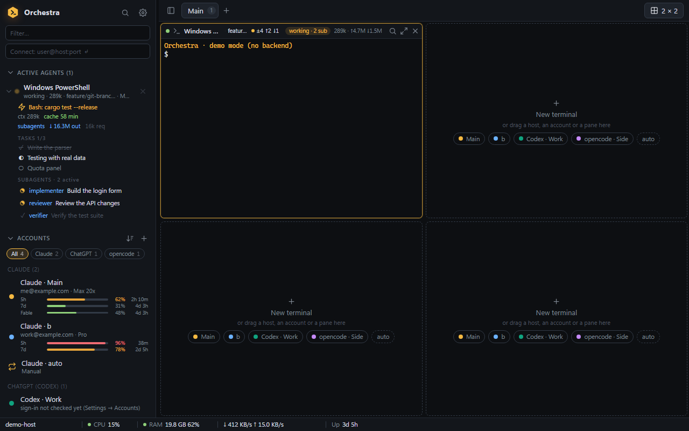

> Screenshots in this repository are taken in the built-in **demo mode** (fake data, no backend). Orchestra is a young project:
> read [Status and known limitations](#status-and-known-limitations) before relying on a feature.

## Why Orchestra

- **Several AI subscriptions, one window.** Keep as many Claude accounts as you have (and Codex or opencode ones), see how much of
  each 5-hour / 7-day quota is left, and open a terminal with the right account in one click.
- **Agents you can watch.** The sidebar shows every running agent (status, current tool, context size, prompt-cache countdown, tasks,
  subagents, tokens). Click a subagent to follow its transcript live.
- **Terminals that survive.** The Rust backend owns the processes: closing the window hides Orchestra to the tray and your sessions
  keep running.
- **SSH without friction.** It uses the system `ssh.exe`, so your keys, ssh-agent, `~/.ssh/config` and `ProxyJump` just work, plus a
  vault for passwords, auto-reconnect and a latency badge.
- **Honest about privacy.** No telemetry; the only network feature beyond SSH is opt-in. See [Security and privacy](#security-and-privacy).

## Features

**Terminals and layouts**
- Adjustable grid (1×1, 2×1, 1×2, 2×2, 3×3, 4×4 …) with draggable aligned splitters, several workspaces (tabs), maximize, search in a
  pane, drag and drop.
- Real PTYs (ConPTY). Output is buffered (2 MiB per terminal) and replayed when the window comes back from the tray.
- PowerShell, cmd, Git Bash and WSL distributions are detected automatically.
- Context menus (sidebar, accounts, grid background, status bar) and a command palette (`Ctrl+Shift+P`).
- **Paste images** into a terminal (`Ctrl+V` with an image in the clipboard, or drop image files on a pane): local panes get the
  path of a PNG saved in a cache folder; in SSH panes the image is uploaded to the server first. **Copy** goes through the system
  clipboard with a visible "Copied" / error notice, also from apps that use the mouse (hold `Shift` to select) and via OSC 52.

**SSH**
- Host list with groups and tags, `~/.ssh/config` import, quick connect (`user@host:port`), optional persistent `tmux` session,
  jump host, per-host color and notes.
- **Vault**: passwords and key passphrases are stored in the **Windows Credential Manager** (never in the state file) and handed to
  `ssh.exe` through an `SSH_ASKPASS` helper, so nothing is typed into the terminal.
- **Host-key policy** for hosts with a saved secret: *Confirm new host keys* (default; shows the fingerprint first) or *Trust on
  first use*, global with a per-host override.
- SSH key manager: list the keys in `~/.ssh`, generate an ed25519 key, copy the public key, install it on a server.
- **Auto-reconnect** with backoff when an established session drops (countdown bar, *Reconnect now*, *Cancel*) and a **latency
  badge** in every SSH pane header (green / amber / red; tooltip with last, min, avg, max and loss). Both are on by default and every
  number is adjustable. A dropped SSH pane is veiled with its state (reconnecting, attempt N, or gave up and why) and, when it comes
  back, a separator marks how long it was down.
- **Files** (SFTP) drawer per SSH pane: browse, filter, upload (button or drop), download, create folders, rename and delete, with
  progress and cancel. It talks SFTP over the same `ssh.exe`, so keys, vault and jump hosts work the same.
- **Port forwarding**: when a program in an SSH pane starts listening (for example a dev server on `localhost:3000`), a notice
  offers to forward it; the pane's ports chip lists the tunnels (open in browser, copy URL, keep for every connection, stop).
  Tunnels reconnect on their own and keep the same local port.
- Optional **server metrics** in the status bar (CPU, RAM, disk, network, uptime of the *server*), read over a second small SSH
  connection; per host, off by default, Linux servers only.

**AI agents (Claude, Codex, opencode)**
- Accounts for the three agents. Claude: one `CLAUDE_CONFIG_DIR` per subscription (history, agents, skills and plugins are shared via
  folder links). Codex: one `CODEX_HOME` each (two run side by side). opencode: one data folder each. Sidebar accounts can be
  **filtered, grouped by provider and sorted**.
- Pick or change the account per terminal; switching relaunches the pane's conversation with the other account.
- Claude conversations **resume after a restart** (`claude --resume <id>`).
- **Usage bars** (5-hour and 7-day windows, time to reset) captured from Claude Code's status line, and an optional, **opt-in**
  query to Anthropic that works even with no terminal open.
- **Active-agents tree** with status, tasks, subagents and tokens per session (main thread and subagents separately); click to
  focus the terminal. **`Ctrl+Shift+A`** jumps to the next agent waiting for you (across tabs) and the *Need attention* list shows
  them all; optional Windows notification when Orchestra is not in front. **Subagent viewer**: a read-only drawer that follows a subagent's transcript live.
- Account selection policy (manual, round-robin, soonest reset, most free quota) and optional **auto-compact** while you are away
  (types `/compact` into an idle Claude shortly before its prompt cache expires; experimental).
- A local **MCP server** lets agents see the hosts and terminals you explicitly allow (per-host permission, audit log). Access per host is
  `read` (agents read terminals), `ask` (they can also run a command with `run_command`, but only after you approve that exact
  command in a dialog) or `full` (they run commands without asking). Every attempt is audited.
- **MCP view** (top bar → **MCP**): every MCP server of every account in one table (Claude user and local scopes, Codex,
  opencode). Test them (tools found, or why not), install one in several accounts at once from a form or a command pasted from a
  README, see side by side when the same server has two versions and make the others equal to one, remove it, and approve, turn on
  or sign in where the account needs it. Every change shows the exact edit first and can be undone. Each server shows roughly how
  many tokens its tool definitions add to every session.
- **Consumption view** (top bar → **Consumption**): where your Claude Code tokens go, read from the local transcripts (nothing is
  sent anywhere). By period (today, 7 or 30 days), session, project, model and subagent, in input-token equivalents or estimated
  USD at API prices; a drawer per pane shows the current session. **Advice** cards point at the biggest wastes (files read whole
  again and again, caches that expire during pauses, a heavy fixed base…) with the saving as "before → after" and the assumption
  behind it. **Copy report for your AI** gives a Markdown summary to paste into a chat, and the MCP server exposes the same report
  as the `usage_report` tool.

**Status bar**
- A thin bar at the bottom: hostname, CPU, RAM, disk read/write, network down/up, uptime, working / waiting agents and the highest
  Claude usage window. Pick, reorder and time the items; right-click it for a quick menu.
- **Per tab**: each tab can have its own items, and context items (focused pane, SSH target, git branch, SSH latency, agent account
  and state) follow the focused pane.

**Git branch chip**
- A chip in the header of every local pane: branch, changed files, commits ahead / behind; amber dot = changes, red = conflicts or a
  rebase / merge in progress. Read-only (`git status` / `rev-parse` only). SSH panes show nothing yet.

**Customization**
- 21 built-in color themes plus import of Windows Terminal, iTerm2, Alacritty and Orchestra themes; export and rename your own.
- Fonts (with an "installed on this PC" check), cursor, scrollback, accent color, notifications, scan intervals.
- **Backup / restore**: *Export everything* to one JSON file (settings, SSH hosts, accounts, themes, workspaces; no passwords or
  logins) and *Import everything* (merge or replace, section by section).
- Interface in **English and Spanish** (follows Windows by default).

## Screenshots

| | |
|---|---|
| 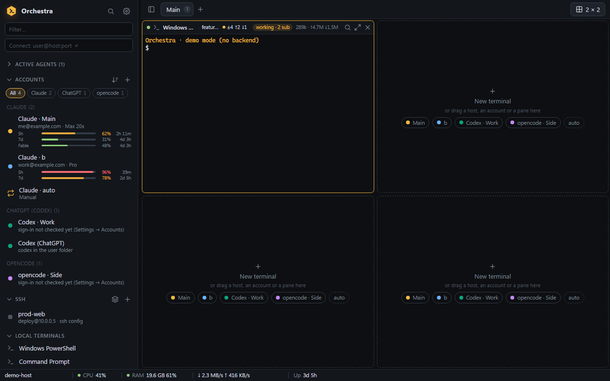<br>Accounts grouped by provider, with usage bars | 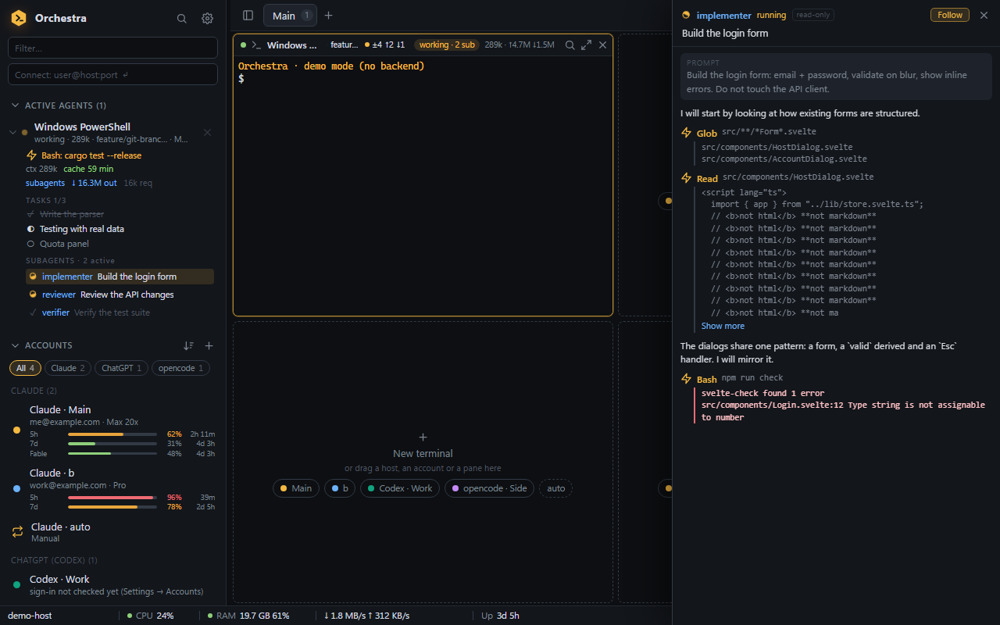<br>Subagent viewer: a live, read-only transcript |
| 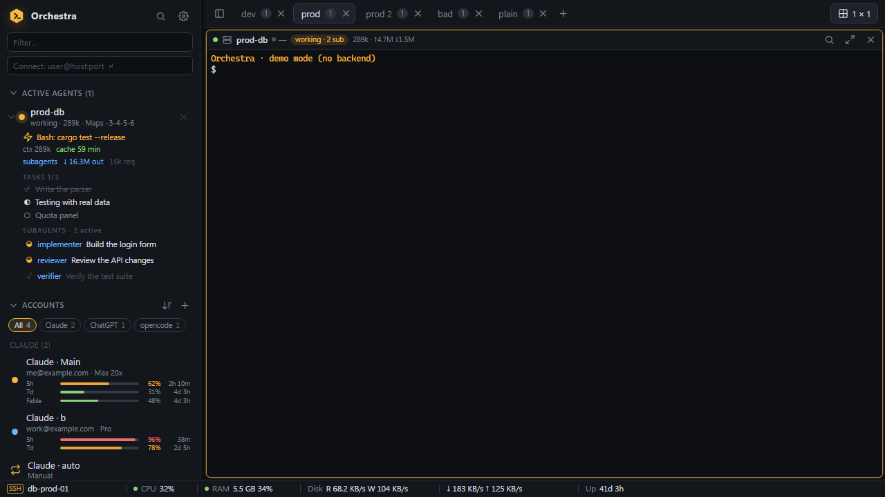<br>Status bar of an SSH tab showing the server's metrics | 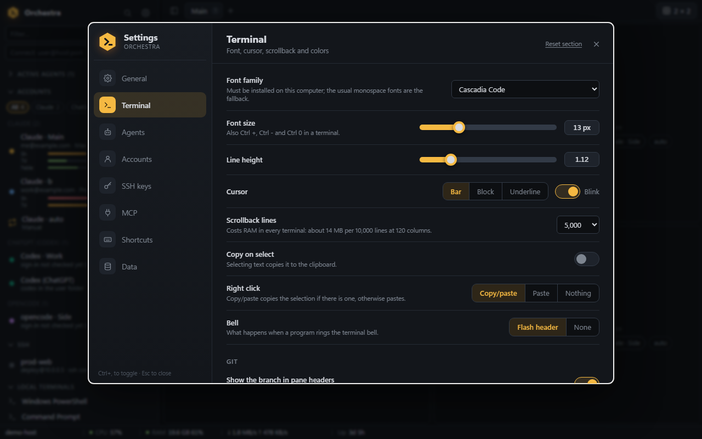<br>Settings → Terminal |
| 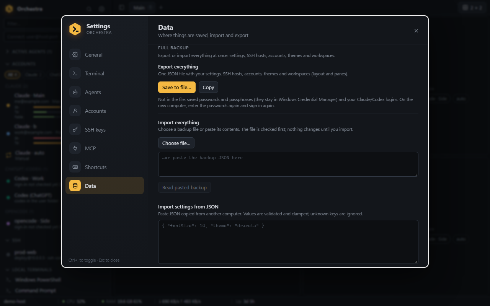<br>Settings → Data: full backup | 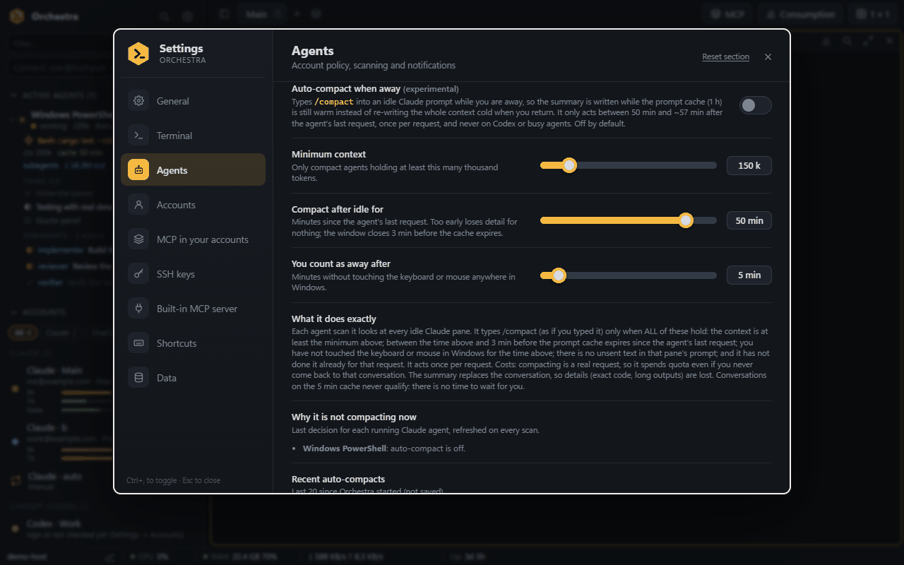<br>Settings → Agents: auto-compact when away, and why it is not acting now |
| 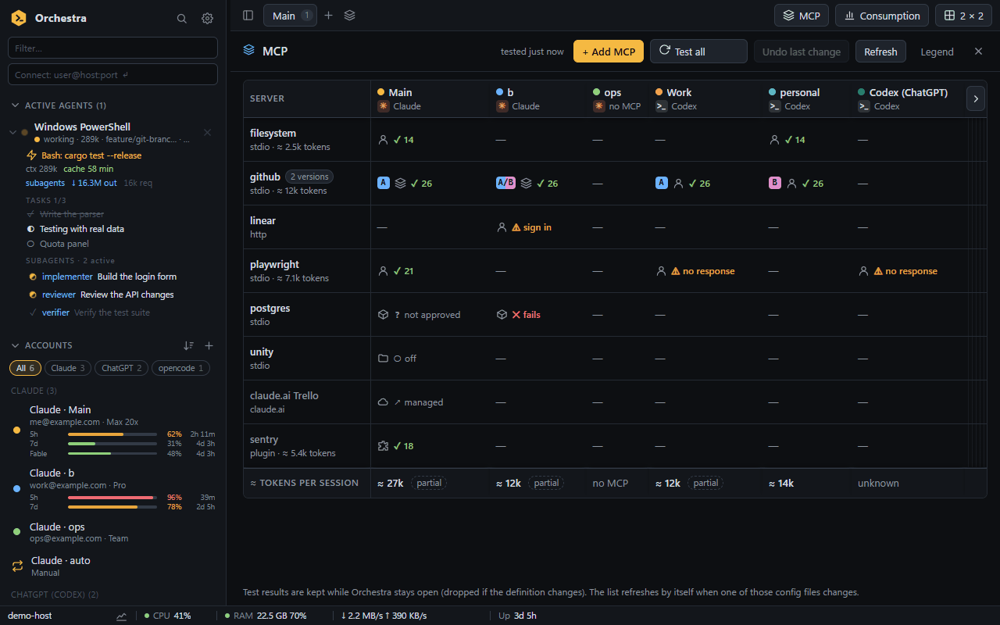<br>MCP view: every server of every account, tested, with two versions of one | 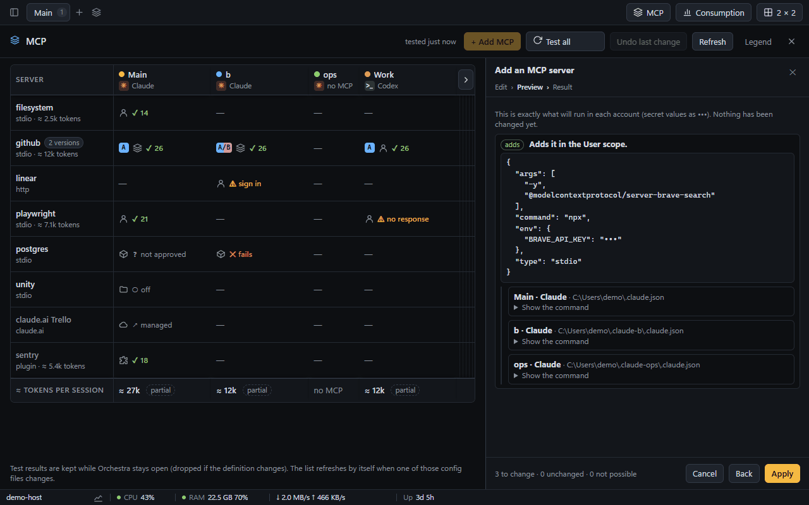<br>Installing a server in three accounts: the exact change, before applying |
| 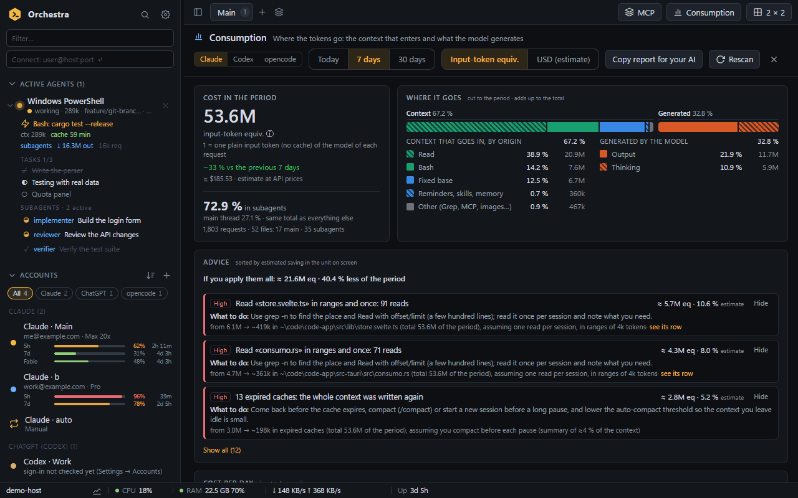<br>Consumption, last 7 days: where the tokens go and advice with the saving | 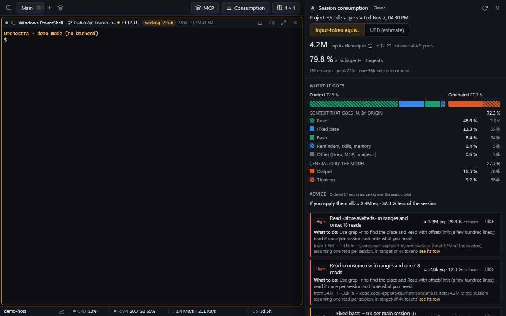<br>Consumption of one session, next to its terminal |

## Install

Get the files from the [Releases](../../releases) page. Two options:

| File | What it is |
|---|---|
| `Orchestra_0.4.3_x64-setup.exe` | NSIS installer, **per-user** (no administrator rights), English / Spanish. |
| `Orchestra_0.4.3_x64-portable.exe` | Portable executable (about 15 MB). Put it anywhere and run it. |

Notes:

- **Windows 10 or 11 (64-bit)** with the **Microsoft Edge WebView2 runtime**. It ships with Windows 11 and current Windows 10;
  if it is missing, install it from Microsoft ("Evergreen Runtime").
- **The binaries are not code-signed**, so Windows SmartScreen may warn ("Windows protected your PC"). If you downloaded the file
  from this repository's Releases page, choose *More info → Run anyway*.
- **Updates:** the installed version checks the Releases page at startup and every 6 hours (Settings → General, can be turned
  off) and shows a notice when there is a new version. *Update* downloads the installer, checks its signature, installs it and
  restarts Orchestra; your panels and Claude sessions are restored. The portable exe only offers to open the download page.
- For SSH you need the OpenSSH client (`ssh.exe`, an optional Windows feature that is usually already installed). For the git chip
  you need `git` on the `PATH`. For agents you need the agent's own CLI (`claude`, `codex`, `opencode`) on the `PATH`.
- **Where your data lives:** `%APPDATA%\dev.orchestra.app\` (`state.json`, `quota\`, `mcp\`, `bin\`). Set the environment variable
  `ORCHESTRA_DATA_DIR` to a folder to use that folder instead (handy for a portable setup or for testing without touching your own
  data). Secrets live in the Windows Credential Manager under the service name `dev.orchestra.app`.

## Quick start

1. Start Orchestra. Press `Ctrl+Shift+T` (or click a **New terminal** tile in the grid) to open your first shell.
2. **Add an account** if you use an AI agent: the `+` next to **ACCOUNTS** in the sidebar → choose Claude, Codex or opencode → create
   it, then sign in in the terminal that opens (`/login` for Claude, the *Sign in* button for Codex and opencode).
3. **Add an SSH host**: the `+` next to **SSH**, or type `user@host:port` in the *Connect* box and press Enter. Choose
   *Password (saved securely)* in the host dialog if you want the vault.
4. Change the **layout** from the grid button at the top right (for example 2 × 2) and drag hosts, accounts or panes into the tiles.
5. Open **Settings** (`Ctrl+,`) to pick a theme and font, tune the status bar, auto-reconnect and more. Press `Ctrl+Shift+P` any time
   for the command palette.

More step-by-step recipes are in the [User guide](docs/USER_GUIDE.md).

## Keyboard shortcuts

These work even while a terminal has the focus. They cannot be rebound yet. The same list is in Settings → Shortcuts.

| Shortcut | Action |
|---|---|
| `Ctrl+,` | Open settings (toggle) |
| `Ctrl+Shift+P` | Command palette |
| `Ctrl+Shift+B` | Show / hide the sidebar |
| `Esc` | Close the open dialog |
| `Ctrl+Shift+T` | New terminal (first shell) |
| `Ctrl+Shift+W` | Close the focused pane |
| `Ctrl+Shift+Enter` | Maximize / restore the focused pane |
| `Ctrl+Shift+F` | Search in the focused pane |
| `Alt+←` `Alt+→` `Alt+↑` `Alt+↓` | Move focus between panes |
| `Alt+1` … `Alt+9` | Go to pane number N |
| `Ctrl+PageUp` / `Ctrl+PageDown` | Previous / next workspace |
| `Ctrl++` / `Ctrl+-` | Bigger / smaller terminal font |
| `Ctrl+0` | Reset the terminal font size |
| `Ctrl+C` | Copy when there is a selection (otherwise sent to the program) |
| `Ctrl+Shift+C` / `Ctrl+V` | Copy the selection / paste |

## Configuration

Everything is in **Settings** (`Ctrl+,`) and applies live. Tabs: **General** (closing behavior, accent color, language, status bar),
**Terminal** (font, cursor, scrollback, themes, git chip), **Agents** (account policy, scan interval, notifications, resume,
usage capture, usage query, auto-compact), **Accounts**, **SSH keys** (host-key policy, auto-reconnect, latency badge, key manager),
**MCP**, **Shortcuts** (read-only) and **Data** (state file, settings import / export, full backup, reset).

Back up with **Settings → Data → Full backup → Export everything**. See the [User guide](docs/USER_GUIDE.md#backup-and-restore) for
what is and is not included.

## Security and privacy

Orchestra runs with your user's permissions and talks only to `127.0.0.1` and to the SSH hosts you configure.

- **No telemetry.** The single exception is the **usage query**, which is **off by default**, needs an explicit confirmation, and
  makes one read-only request to `api.anthropic.com` per signed-in Claude account.
- **The state file (`state.json`) holds no secrets**: layout, hosts, accounts and settings only.
- **SSH passwords and passphrases** go to the Windows Credential Manager; no command returns them to the UI.
- **Claude / Codex / opencode credentials are never copied or modified.** By default Orchestra does not read Claude's OAuth tokens;
  only the opt-in usage query does (two fields of `.credentials.json`, never stored or logged).
- The **MCP server** listens on `127.0.0.1` only, behind a secret token, and only exposes hosts and terminals you allow. The `run_command` tool is the only one that can change anything: `read` hosts refuse it, `ask` hosts need your approval each time, `full` hosts run it directly (see [docs/SECURITY.md](docs/SECURITY.md)).
- Backups and exported hosts contain **no secrets**; an imported backup is treated as untrusted data and validated.

Full model, per feature: [docs/SECURITY.md](docs/SECURITY.md). To report a vulnerability, see [SECURITY.md](SECURITY.md).

## Build from source

Requirements: Windows 10/11, **Node.js 20.19+ or 22.12+** (CI uses 22), **Rust stable** with the MSVC toolchain (Visual Studio Build
Tools, "Desktop development with C++"), and the WebView2 runtime.

```powershell
npm install
npm run tauri dev                              # development with hot reload
npm run build                                  # build the web UI only (output in dist/)
npx tauri build --debug --no-bundle            # debug executable, no installer
npx tauri build --bundles nsis                 # release build + NSIS installer
```

The release executable is written to `src-tauri\target\release\orchestra.exe` and the installer to
`src-tauri\target\release\bundle\nsis\`.

### Checks

```powershell
npm run check                                  # svelte-check (types)
npm test                                       # node --test: pure TypeScript modules
npm run i18n:check                             # dictionaries, unused keys, hard-coded text
cd src-tauri; cargo test       # Rust tests (real ConPTY, loopback HTTP, parsers, security)
```

The UI also runs in a plain browser (`npm run dev`, open http://127.0.0.1:1420/) in **demo mode** with fake data, which is how the
screenshots were made.

To try a real build without touching your own data, set `ORCHESTRA_DATA_DIR` to an empty folder (and `WEBVIEW2_USER_DATA_FOLDER` to
another one) before starting it. The MCP server prefers a fixed port (47821), so two instances cannot both have it. Contributing
details are in [docs/CONTRIBUTING.md](docs/CONTRIBUTING.md).

## Project layout

```
src/                  Svelte 5 app (components/) and pure TypeScript logic (lib/, tested with node --test)
src/lib/locales/      UI dictionaries: en/ (base) and es/
src-tauri/src/        Rust backend: PTYs, SSH helpers, vault, agents, quota, MCP server, git, metrics
src-tauri/tests/      Rust integration tests (askpass helper)
scripts/              i18n checker and its tests
docs/                 Architecture, security, i18n, user guide, contributing, screenshots, internal dev notes
.github/              CI workflow, issue and pull request templates
```

Documentation index: [docs/README.md](docs/README.md).

## Status and known limitations

Orchestra 0.4.3 (0.1.0 was the first public release) is a one-person project. New in 0.4.3: Claude's markdown titles, bold and italic painted with the terminal theme's colors in Claude panes, and an option to make each Claude account use the terminal theme; tested with unit tests on real Claude Code output and in the browser demo, not yet in the desktop window with live sessions. New in 0.4.2: Claude Code themes generated from the terminal themes, including one that follows the terminal theme. New in 0.4.1: letter spacing for the terminal, and the font list now shows every installed font (it only offered a fixed set before). New in 0.4.0: automatic updates, SFTP files drawer, port forwarding, image paste and reliable copy, visible SSH reconnection and the *Need attention* list, MCP view and Consumption view; covered by unit tests, fake servers, a local sshd and the browser demo, but SFTP, tunnels and image upload have not been used yet against a real server from the desktop window (see the [changelog](CHANGELOG.md)). New in 0.3.0: usage history chart, SSH host folders, saved workspaces, agent card and notification sounds, tested with unit tests and in the browser demo but not yet with live agents or a real SSH server in the desktop build. New in 0.2.0: the MCP `run_command` tool, which is covered by automated tests with a fake runner and real local processes but has **not** been run against a real SSH server by the author yet. What is verified and what is not:

- **Verified by automated tests**: grid model, settings, account policies, usage formatting, auto-compact decision, theme import,
  backup, i18n dictionaries (TypeScript); PTY, `~/.ssh/config` parser, token accounting, MCP protocol and security checks, askpass
  helper, host-key flow, usage query against a fake server (Rust). Security-relevant tests were checked by planting bugs.
- **Verified by hand** against real software: SSH password / passphrase login and host-key policies against a temporary sshd (OpenSSH
  9.5 client); the MCP server with a real Claude Code client; the agent sidebar against live Claude sessions on the author's machine;
  the usage endpoint once, for one Max account; Codex / opencode folder isolation against the real binaries.
- **Not verified in real-world use**: reconnecting after a *real* SSH connection drop; server metrics against real servers; usage bars
  against a real Claude status-line payload; `/compact` typed into a real pane; a real ChatGPT / opencode login from inside a pane.
- **The installer has not been install-tested** on a clean machine, and **CI has never run** (the workflow exists but has not been
  executed on GitHub yet).
- **Windows only.** No macOS or Linux build.
- **Not included**: MCP typing into terminals and file transfer over MCP (only `run_command` exists), snippets and broadcast, usage bars for
  Codex / opencode. SSH panes do not show the git chip; remote metrics are Linux-only; Codex / opencode sessions are only detected by
  process name (no tokens or session data).
- Code comments, `docs/DISENO.md` and the files in `docs/dev-notes/` are largely in Spanish.

The testing strategy is described in [docs/ARCHITECTURE.md](docs/ARCHITECTURE.md#testing-strategy) and the per-feature working notes
are in [docs/dev-notes/](docs/dev-notes/).

## Contributing

Issues and pull requests are welcome. Read [docs/CONTRIBUTING.md](docs/CONTRIBUTING.md) first; user-visible changes go in
[CHANGELOG.md](CHANGELOG.md).

## License

[MIT](LICENSE). Created by [@jonirulah](https://github.com/Jonirulah).
