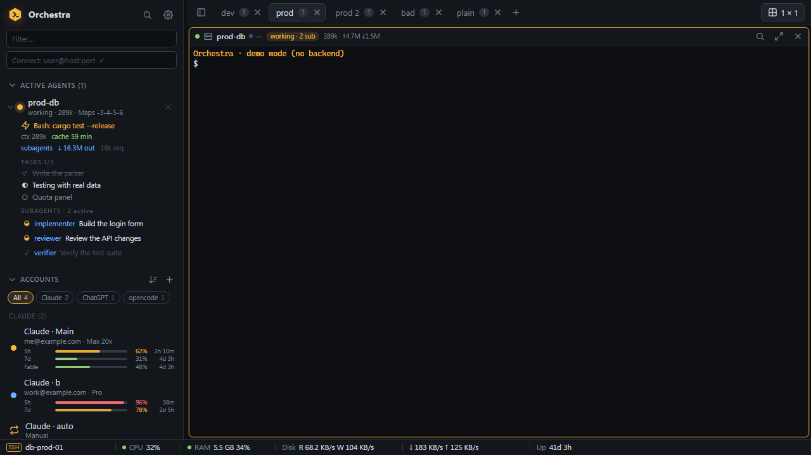
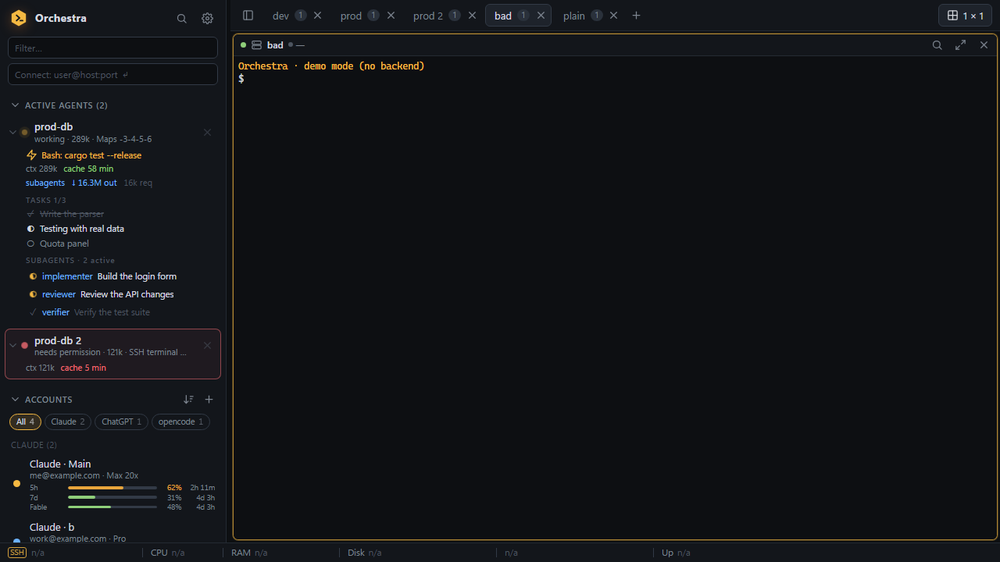
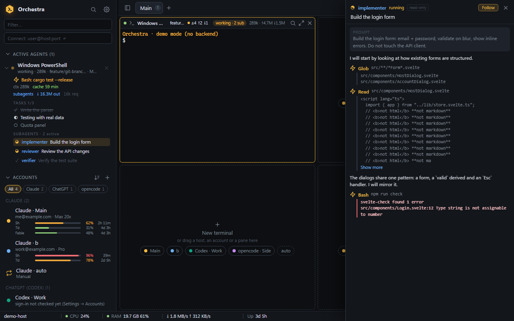
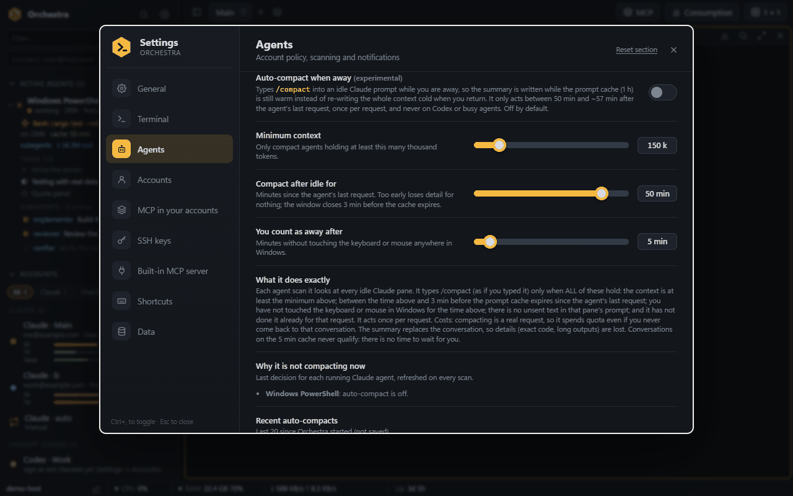
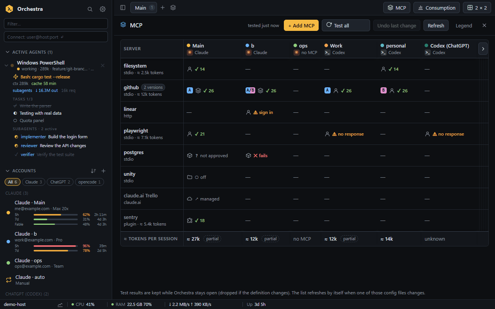
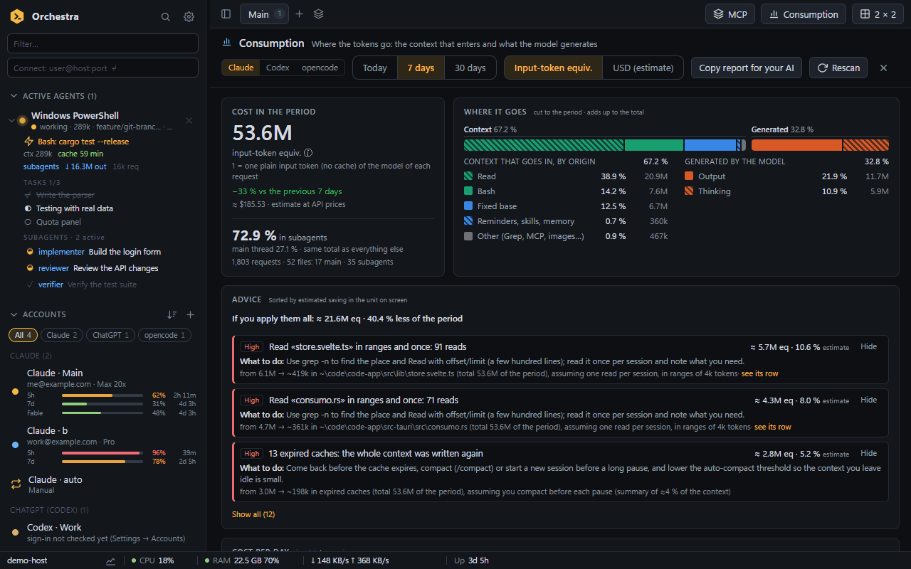
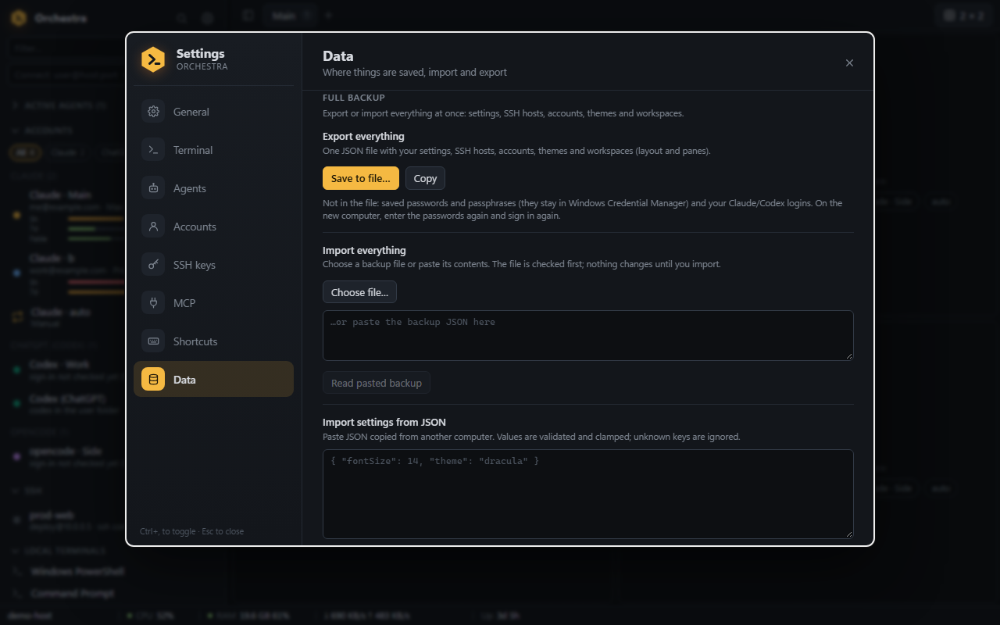

# User guide

Task-oriented recipes for Orchestra 0.1.0. Menu and button names are written as they appear in the English interface
(Spanish names are in [README.es.md](../README.es.md) and in Settings once you switch the language). For the overview see the
[README](../README.md); for how things work inside, [ARCHITECTURE.md](ARCHITECTURE.md); for what is stored where,
[SECURITY.md](SECURITY.md).

Contents: [Accounts](#accounts) · [SSH](#ssh) · [Status bar](#status-bar) · [Git chip](#git-branch-chip-and-folder-tracking) ·
[Agents](#agents-subagents-and-usage) · [MCP view](#mcp-view) · [Consumption](#consumption) · [Themes](#themes) · [Backup and restore](#backup-and-restore) ·
[Troubleshooting](#troubleshooting)

## Accounts

Orchestra manages one **account** per agent login. Each account is a folder; the folder is what keeps the accounts apart.

### Add a Claude account

1. In the sidebar, press the `+` next to **ACCOUNTS** (tooltip: *Add account (Claude, Codex or opencode)*). You can also
   right-click the sidebar and choose **Add account…**, use **Add account…** in Settings → Accounts, or use the command palette.
2. Leave **Agent** on Claude and type a **Name** (for example `Work`).
3. Press **Create and open login**. Orchestra creates a new folder for the account (the dialog shows its path) and opens a terminal
   with that account.
4. In that terminal type `/login` and sign in with the subscription you want.

Claude accounts share history, agents, skills and plugins with your main account through folder links, so a conversation can be
continued with any account.

If you already have `~/.claude*` folders, Orchestra finds them by itself; Settings → Accounts → **Rescan folders** looks again.

### Add a Codex or an opencode account

1. Press `+` next to **ACCOUNTS** and change **Agent** to ChatGPT (Codex) or opencode. The dialog warns if the command is *not found
   on PATH*: install it first.
2. **Codex:** each account is its own Codex home (`CODEX_HOME`), so two Codex accounts can run side by side. Or tick *Use my existing
   Codex folder (~/.codex) as it is* to point the account at your current Codex without creating or changing anything.
3. **opencode:** each account gets its own data folder and runs opencode with a private server, so it never touches your main
   opencode data. Or tick *Use my existing opencode data (shared, not isolated)*.
4. Press **Create**, then **Sign in** (also available in Settings → Accounts and in the account's right-click menu). A terminal runs
   `codex login` / `opencode auth login` so you can finish the login in your browser.
5. **Check sign-in** (Settings → Accounts, or *Check sign-in status* in the right-click menu) asks the agent's own status command
   whether the account is signed in. Only the answer is kept; credential files are never read.

Usage bars and automatic account selection are only for Claude accounts.

### Filter, group and sort the accounts list

Next to the `+` of **ACCOUNTS** there is a small sort button (*Sort, group and filter accounts*):

- **Sort by**: Manual order, Name (A to Z), Most free (Claude), Resets soonest (Claude). The last two only sort Claude accounts;
  the others keep their order at the end.
- **Group by provider**: Claude, ChatGPT (Codex) and opencode sections.
- **Show**: one provider or **All accounts**. The chips under the title (`All`, `Claude`, `ChatGPT`, `opencode`) do the same.

The choice is remembered. Settings → Accounts has the same *Account order* and *Group by provider* options.

### Other account actions

Right-click an account: **New terminal with this account**, **Sign in…** / **Sign in again…**, **Check sign-in status**, **Rename**,
**Change color**, **Open folder in Explorer**, **Copy folder path**, **Remove from Orchestra**. Removing only forgets the account
here: its folder and sign-in are never deleted. Settings → Accounts → **Restore N removed** brings them back.

## SSH

### Open an SSH host

- **Quick connect**: type `user@host:port` in the *Connect* box at the top of the sidebar and press Enter.
- **Saved host**: press `+` next to **SSH** (*New host*), fill in the dialog (Name, Group, Host or IP, User, Port, Authentication, Tags,
  Command on connect…) and **Save**. Then click the host in the sidebar, or drag it into a free tile of the grid.
- Orchestra runs the system `ssh.exe` inside the pane, so ssh-agent, `ProxyJump` and your `~/.ssh/config` apply as usual. The host
  dialog has a *Jump host (ProxyJump)* field and an optional persistent **tmux** session (after a dropped connection you pick up
  where you left off).

### Save a password or a key passphrase in the vault

1. In the host dialog, set **Authentication** to *Password (saved securely)*, or to *Private key file* and fill the optional
   passphrase.
2. Type the secret once and **Save**. The host shows *Saved in Windows Credential Manager*. It is never shown again and never
   written to the settings file; Orchestra passes it to `ssh` without typing it into the terminal.
3. To remove it, use **Clear saved secret** and save.

You can also reuse a passphrase saved for another key (*Use the passphrase saved for «name»*). Settings → SSH keys lists the keys in
`~/.ssh` (*passphrase saved* tag, *Forget saved passphrase*), generates an ed25519 key (*Generate a new key*) and installs a public
key on a server (*Install on server…*).

**First connection to a host with a saved secret.** Because the helper cannot answer ssh's "trust this server?" question, Orchestra
asks first. With the default policy, **Confirm new host keys**, a dialog shows the server's fingerprints; check them against a
trusted source and press **Trust and connect**. The alternative, **Trust on first use**, accepts an unknown key silently the first
time (a *changed* key is always rejected). Choose the policy in Settings → SSH keys (*Host key verification*) or per host in the
dialog (*Host key check*). Hosts without a saved secret behave as ever: ssh asks you in the terminal.

### Import hosts from `~/.ssh/config`

Press the layered-squares button next to `+` in the **SSH** section (*Import / export hosts*) and choose **Import all from
~/.ssh/config (N)**, or right-click the sidebar and choose **Import from ~/.ssh/config**. Aliases that are already hosts are skipped
("Nothing to import" if all are). Imported hosts show a *From ~/.ssh/config* tag. The same menu has **Export hosts (JSON, no secrets)**.

### Auto-reconnect and latency settings

Both live in Settings → SSH keys and are **on by default**.

- **Auto-reconnect** (*Reconnect dropped SSH sessions*): when an established session drops, the pane shows *Connection lost —
  reconnecting in N s* with **Reconnect now** and **Cancel**. Options: *Maximum attempts* (0 = no limit), *First delay*, *Backoff
  factor*, *Longest delay*, *Minimum uptime*, *Exit codes that reconnect* (*Any non-zero* or *Only 255*) and *Flash the header when it
  reconnects*. It never retries after a clean exit, a wrong password, an unknown host key or a user action such as closing the pane.
- **Latency badge** (*Show latency in SSH panes*): a badge in the pane header (`● 42 ms`) with the TCP connect time to the host's SSH
  port, green / amber / red. Hover for last, min, avg, max and loss. Options: *Measure every*, *Probe timeout*, *Amber from*, *Red
  above*, *Samples kept*, *Failures before red*, *Show the unit*. It opens and closes a connection without sending data, and hosts
  reached through a jump host are not measured.

### Server metrics in the status bar

In the host dialog, tick **Show server metrics in the status bar**. Then, while a pane of that host is open, the status bar shows the
*server's* CPU, RAM, disk, network and uptime instead of your computer's (marked with `ssh` and the server name). Caveats:

- It opens a **second, small SSH connection** to the server (shared by all panes of that host). It counts toward `fail2ban` and
  `MaxSessions` limits and uses the same saved credentials.
- **Linux servers only.** Other systems show *Remote metrics need a Linux server.*
- **The host key must already be trusted.** The monitor never accepts a new key; if the host is not in `known_hosts` you see *host key
  not trusted yet. Connect with a normal pane first.* Open a normal pane to that host once.
- Logins that need an interactive answer (2FA, keyboard-interactive) are reported once as *needs interactive login* and not retried.
- Off by default and per host. The reading interval is *Server metrics interval* in Settings → General → Status bar (2–10 s).

When it cannot read the server, the bar shows `n/a` and a tooltip with the reason:

### Files (SFTP)

The folder button in an SSH pane header opens the **Files** drawer for that host (hosts added to Orchestra; panes opened straight
from `~/.ssh/config` do not have it). It uses SFTP over the same `ssh.exe`, keys, vault secret and jump host as the pane.

- Browse, go up, type a path, filter by name, show hidden files, refresh.
- **Upload…** or drop files from Explorer onto the drawer; download a file to your Downloads folder (*Show in folder* afterwards).
- New folder, rename and delete (asks first). Transfers show progress and can be cancelled.

### Port forwarding

When a program in an SSH pane starts listening on a port (for example a dev server printing `http://localhost:3000`), a notice
offers **Forward**, **Open in browser** or **Ignore**. Forwarding starts an SSH tunnel to `127.0.0.1:<port>` on your PC (another
local port if that one is busy). The ports chip in the pane header lists the tunnels: open in browser, copy the URL, **keep** it
(start it every time you connect to that host) or stop it. A tunnel that drops reconnects on its own and keeps its local port.

### When an SSH connection drops

The pane is veiled with its state: reconnecting (attempt N, with the countdown), or *gave up* with the cause (login rejected, host
key, network unreachable, refused, timeout…) and **Restart** / **Close**. When it comes back, a separator line in the terminal says
when it reconnected and how long it was down.

## Status bar

Settings → General → **Status bar**: *Show status bar*, the list of **Items** (tick to show, arrows to reorder), *Update every* (1–10 s)
and a live *Preview*. Items: Hostname, CPU, RAM, Disk R/W, Network down / up, Uptime, Agents, Claude usage, and the *context* items
Focused pane, Target (user@host:port), Git branch, SSH latency, Agent account and Agent state. On narrow windows the items on the right
are dropped first. Right-click the bar for **Hide status bar** and **Status bar settings…**.

### Customize it for one tab

1. Right-click the bar while that tab is active and choose **Customize for this tab**.
2. Edit the items in the settings that open. The note says *This tab has its own list of items. Changes here edit this tab only.*
3. To go back, choose **Use default for all tabs** in the right-click menu, or **Reset this tab to default** in the settings.

**Adapt bar to the pane** makes tabs without their own list show target and latency for SSH panes, or the git branch for panes
inside a repository. Local items always describe *this computer*, not the server, unless server metrics are on for that host.

## Git branch chip and folder tracking

Each local pane shows a chip with its git branch, plus `±N` changed files and `↑`/`↓` commits ahead / behind. Hover for the
repository path and staged / unstaged / untracked counts; click to copy the branch name. An amber dot means changes; red means
conflicts or a rebase / merge / cherry-pick / revert / bisect in progress.

Settings → Terminal → **Git**: *Show the branch in pane headers*, *Show change counts*, *Refresh every*, and **Track the folder in
PowerShell panes**. Orchestra learns a pane's folder from the shell itself (OSC 9;9 / OSC 7); plain PowerShell panes get a tiny
prompt wrapper that reports the folder at each prompt so the chip follows `cd`. Your own prompt is kept and panes with custom
commands are not touched. Turn the option off if you prefer; it applies to panes opened afterwards. If `git` is not installed the
settings say so and the chip stays hidden. SSH panes show no chip.

## Agents, subagents and usage

### The active-agents tree and the subagent viewer

**ACTIVE AGENTS** lists every running agent with its status (*working*, *needs permission*, *idle* …), the current tool, context size
(`ctx`), prompt-cache countdown (`cache 58 min`; red and amber when it is about to go cold), tasks, subagents and tokens per session
(main thread and subagents separately). Click an agent to focus its terminal.

Click a **subagent** to open the **subagent viewer**, a read-only drawer on the right that shows its prompt, assistant text, tool
calls, results and errors as they happen. **Follow** keeps the view at the latest event (it switches off if you scroll up);
**Show more** expands long outputs; **Go to pane** jumps to its terminal; `Esc` or the close button closes it.

### Usage bars

Claude accounts show **5 h** and **7 d** bars with time to reset in the sidebar. They come from two sources:

1. **Capture** (Settings → Agents → *Capture usage limits*, on by default): Orchestra adds a small status-line wrapper to Claude
   started from Orchestra and records the percentages. It applies to terminals started after you change it, and only covers accounts
   that have a running session.
2. **Usage query** (opt-in; Settings → Agents → *Usage from Anthropic* → *Check usage for all accounts*): works for every signed-in
   account, even with no terminal open. Turning it on needs an explicit confirmation, because this is the only feature that reads
   Claude's sign-in token and asks Anthropic's servers for your usage (read-only). Choose the interval (2–30 min); **Test now** shows
   the answer. Details: [SECURITY.md](SECURITY.md#usage-query-opt-in).

Related Agents settings: *Account selection policy* (also in the sidebar via **Claude · auto**), *Warn when an account nears its 5 h
limit*, *Resume Claude conversations on restart* and *Auto-compact when away* (experimental). Auto-compact never types over a
prompt with unsent text; *Why it is not compacting now* shows the last decision for each running Claude agent.

## MCP view

**MCP** in the top bar opens a table with every MCP server (rows) of every account (columns): Claude user and local scopes, Codex
and opencode. Each cell says whether the server is there, on or off, and, once tested, how many tools it offers or why it failed.

- **Test all** (or a single cell) starts each server the way the agent would and lists its tools. Results are kept while Orchestra
  stays open. The bottom row is a rough estimate of the tokens the tool definitions add to every session of that account.
- **Add MCP**: fill the form or paste the install command or JSON from a server's README (**Read it**), pick the target accounts and
  press **Preview**. The preview shows the exact change per account (secret values masked); **Apply** writes it.
- When the same server has **two versions** (A/B) in different accounts, open its row to see what differs and **Make all A**.
- **Remove** takes a server out of the chosen accounts and scopes. Cells that need something from you show the action: approve a
  project server, turn it on, or sign in.
- **Undo last change** restores the files as they were before the last apply.

## Consumption

**Consumption** in the top bar shows where the tokens of Claude Code go, computed from the transcripts on this PC (nothing is sent).

- Pick **Today**, **7 days** or **30 days**, and the unit: *Input-token equiv.* (one plain input token of the model that used it) or
  *USD (estimate)* at API prices. Breakdowns by origin (reads, Bash, fixed base, skills and memory, output, thinking), session,
  project, model and subagent.
- **Advice** cards are sorted by estimated saving. Each one says what to do, the saving as "before → after" and the assumption it
  makes; **Hide** dismisses one, **see its row** jumps to the data behind it.
- The chart button in a pane header opens the same analysis for that pane's session, next to the terminal.
- **Copy report for your AI** copies a Markdown summary (short or full) to paste into a chat. Agents can get the same report from
  Orchestra's MCP server with the `usage_report` tool.

## Pasting images and copying

- **Paste an image**: with an image in the clipboard, `Ctrl+V` (or right click) in a pane pastes it. In a local pane Orchestra saves
  it as a PNG in a cache folder (cleaned after 24 hours, up to 25 MB) and types its path; in an SSH pane it uploads it to
  `~/.cache/orchestra-paste/` on the server and types the remote path. You can also drop image files on a pane.
- **Copy**: `Ctrl+Shift+C`, right click with a selection, copy on select, or OSC 52 from a remote app all go through the system
  clipboard and show a short *Copied (N)* notice, or the error if it failed. In apps that capture the mouse (Claude Code, opencode)
  hold `Shift` while dragging to select.

## Agents that need you

`Ctrl+Shift+A` jumps to the next agent that is waiting for you, switching tab if needed; press it again for the next one. The
*Need attention* block in the sidebar lists them. When an agent starts waiting and the window is not in front, Orchestra flashes
the taskbar and, with *Notify when an agent needs permission* on (Settings → Agents), shows a Windows notification.

## Updates

The installed version checks the GitHub releases at startup and every 6 hours (Settings → General: turn it off or *Check now*).
When there is a new version the top bar shows it; **Update** shows the release notes, warns if agents are working or SSH sessions
are open, downloads the installer, checks its signature, installs it and restarts Orchestra (Claude sessions are restored). The
portable exe only offers to open the download page. Versions 0.2.0 and 0.3.0 have no updater: install 0.4.0 by hand once.

## Themes

Settings → Terminal → **Color theme**. There are 21 built-in themes (dark and light) and applying one affects every open terminal at
once.

- **Import**: *Import theme file…*, drop files on the zone, or **Paste theme text**. Supported: Windows Terminal color schemes
  (`.json`), iTerm2 (`.itermcolors`), Alacritty (`.toml`) and Orchestra JSON. Files over 256 KB are refused. Ready-made themes:
  windowsterminalthemes.dev and iterm2colorschemes.com. Orchestra warns about low contrast or missing colors.
- **Export**: select a custom theme, then **Export** (downloads a JSON file) or **Copy JSON**. Custom themes can also be renamed and deleted.

Fonts (with an installed-on-this-PC check), cursor, scrollback and the rest are in the same tab. Settings → General holds the accent
color and the language (English / Español / System default).

## Backup and restore

Settings → Data → **Full backup**.

- **Export everything → Save to file…** (or **Copy**): one JSON file with your **settings, SSH hosts, accounts, themes and
  workspaces** (layout and panes).
- **Not included**: saved passwords and key passphrases (they stay in Windows Credential Manager), your Claude / Codex / opencode
  logins and tokens, the usage-query switch, and the live state of open panes. On the new computer you enter the passwords again and
  sign in to each agent again.
- **Import everything → Choose file…** (or paste the JSON and **Read pasted backup**). The file is checked first and a summary lists
  what it contains with a checkbox per section. Choose **Merge** (add what is missing; duplicates are skipped) or **Replace** (the
  ticked sections become the file's; running terminals in replaced workspaces are closed; needs a second click).
- Only import backups you made yourself: workspace panes **launch the commands stored in the file**. Orchestra warns while
  *Workspaces* is ticked.

The same tab can copy your settings as JSON and import them on another computer (*Copy settings as JSON* / *Import settings from
JSON*; workspaces and hosts are not included), open the data folder, and **Reset ALL settings** (workspaces, hosts and accounts are kept).

## Troubleshooting

| Problem | What to check |
|---|---|
| **Terminal colors look wrong, washed out or unreadable** | Pick another theme in Settings → Terminal → *Color theme*. A custom theme may have been imported with missing colors (Orchestra fills them from the default and warns about low contrast). Programs that draw their own colors still use them. |
| **Windows says "Windows protected your PC" (SmartScreen)** | The binaries are not code-signed. If you downloaded them from this repository's Releases page, choose *More info → Run anyway*. |
| **The window is blank or Orchestra does not start** | Orchestra needs the Microsoft Edge WebView2 runtime. It is part of Windows 11 and current Windows 10; if it is missing, install the "Evergreen Runtime" from Microsoft. |
| **An SSH pane says `ssh` is not recognized** | The OpenSSH client is missing or not on the `PATH`. Install it from Windows → Settings → Optional features → *OpenSSH Client*, then open a new pane. |
| **Saving a password fails: "Credential store unavailable" or "Could not save to Windows Credential Manager"** | Orchestra uses the Windows Credential Manager of your user. Check that you are signed in to a normal Windows session and that the Credential Manager is not blocked by policy. Without the vault you can still use ssh-agent or a key without passphrase. |
| **The git chip does not appear** | Install Git for Windows and restart Orchestra (Settings → Terminal → Git says when `git` is not found). The chip is only for local panes and can be switched off. |
| **Server metrics show `n/a`** | Hover the item for the reason: host key not trusted yet (open a normal pane first), needs interactive login, not a Linux server, or the server is unreachable. |
| **A host with a saved password will not connect after a restart** | Panes restored at startup are not host-key-scanned and fail if the key is no longer in `known_hosts`. Use the pane's restart button to go through the confirmation dialog again. |
| **Claude/Codex/opencode account says not signed in** | Settings → Accounts → *Sign in*, then *Check sign-in*. Usage bars need a Claude account. |
| **A second Orchestra cannot start its MCP server** | The server prefers port 47821. If another instance has it, a different port is used and Settings → MCP says so. |
| **Starting over** | Close Orchestra and move `%APPDATA%\dev.orchestra.app\` aside (or set `ORCHESTRA_DATA_DIR` to an empty folder to try a clean profile). Saved passwords stay in Windows Credential Manager under `dev.orchestra.app`. |

Found a bug? [Open an issue](../../../issues/new/choose) with your Orchestra version (Settings → Data, bottom of the page), what you
did and what you expected. Do not paste secrets.
